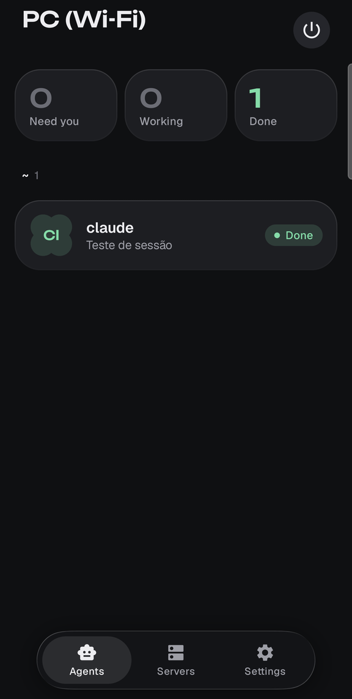
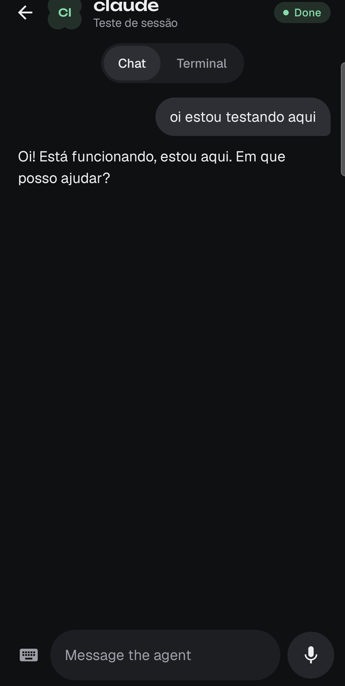

# OpenHerdr

A native Android companion for [herdr](https://herdr.dev), the terminal workspace manager for AI coding agents.
See which agents need you, read their output, answer prompts and get notified — from your phone, over plain SSH.

<p>
  
  
</p>

> OpenHerdr is an independent community project. It is not affiliated with or endorsed by the herdr project.

## Why another herdr client

- **Nothing runs on your server.** OpenHerdr opens SSH `direct-streamlocal` channels straight to herdr's own socket
  (`~/.config/herdr/herdr.sock`). No bridge binary, no install script, no extra daemon, no open ports.
- **Your key never leaves the phone.** The SSH key is a P-256 key generated inside the Android Keystore
  (StrongBox when available). The app can ask it to sign; nobody can copy it out.
- **Explicit server trust.** The first connection shows the server's host key fingerprint and waits for you to confirm it.
  A different key later is refused, not silently accepted.
- **No cloud.** No accounts, no telemetry, no push service, no over-the-air code updates. Notifications are generated
  on the device from the live SSH connection.
- **Native.** Kotlin, Jetpack Compose and Material 3 Expressive.

## Features

- Dashboard of every herdr agent grouped by workspace, with live status (needs you / working / done / idle)
- **Chat view** of Claude Code, Codex and Pi conversations (messages, Markdown, tool calls with their output), read
  from the agent's own session file over SFTP; the colored terminal is one tap away
- One-tap answers (`y`, `n`, `Enter`, `1`–`3`, arrows, `Esc`, `Ctrl+C`), with the waiting prompt shown inline
- **On-device dictation** with NVIDIA Parakeet TDT 0.6B v3 (25 European languages incl. Portuguese) via sherpa-onnx;
  audio never leaves the phone
- Notifications when an agent blocks on you or finishes
- Several servers (for example LAN and WireGuard addresses of the same machine) and named herdr sessions

Works with any agent herdr understands: Claude Code, Codex, Pi, OpenCode, Copilot CLI and more. For the most accurate
status, install herdr's integrations on the server, e.g. `herdr integration install claude`.

## Setup

1. On the server: `sshd` with public key login (stream local forwarding is on by default in OpenSSH) and herdr running.
2. In the app: open **Device key** (lock icon) and share the public key.
3. On the server, add it to `~/.ssh/authorized_keys`. It only needs socket forwarding, so you can restrict it:

   ```
   restrict,port-forwarding ecdsa-sha2-nistp256 AAAA... openherdr@phone
   ```

4. Add the server in the app (host, port, user, optional herdr session) and connect.
5. Compare the fingerprint the app shows with `ssh-keygen -lf /etc/ssh/ssh_host_<type>_key.pub` on the server, then trust it.

Away from home, reach the server through a VPN such as WireGuard or Tailscale rather than exposing SSH to the internet.

On Samsung and other aggressive battery managers, add OpenHerdr to the apps that never sleep so notifications keep arriving.

## Build

Requirements: JDK 17, Android SDK with platform 37.2.

```sh
export JAVA_HOME=/path/to/jdk-17
scripts/fetch-sherpa.sh             # speech runtime AAR, checksum-verified
./gradlew :app:assembleRelease      # app/build/outputs/apk/release/app-release.apk
./gradlew :app:testDebugUnitTest    # unit tests
```

Integration tests run against a real `sshd` and herdr; see [AGENTS.md](AGENTS.md).

The speech model is not bundled; see [AGENTS.md](AGENTS.md) for where to put it.

## License

[Apache License 2.0](LICENSE). Bundled fonts: Unbounded and Geist (SIL OFL 1.1, see `licenses/`). Uses sherpa-onnx
(Apache-2.0), Kyant Backdrop (Apache-2.0), multiplatform-markdown-renderer (Apache-2.0), JSch (BSD). The Parakeet
model is NVIDIA's, under CC-BY-4.0.
